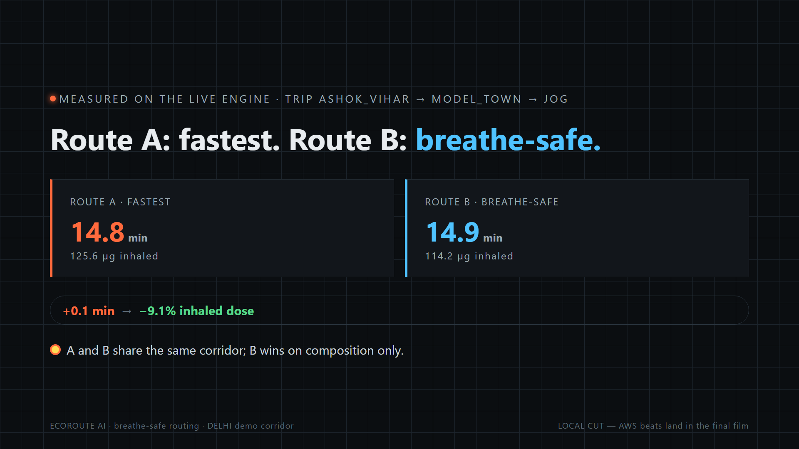
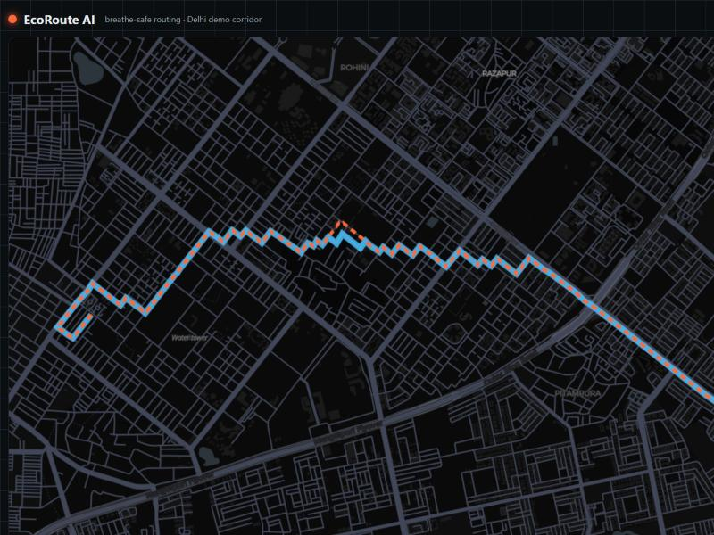

# EcoRoute AI

**Navigation ranked by what you breathe, not just how fast you arrive.**

A Delhi jogger's fastest route grazes a market corridor every time. EcoRoute computes the
**inhaled dose of every street segment** (`dose(µg) = C(µg/m³) × IR(m³/h) × minutes/60`) on a
real OpenStreetMap graph and returns TWO routes: regular fastest, and breath-safe. A recent
demo trip: **+3.1 min → −10.6% inhaled dose** (17.9 vs 14.8 minutes; 119.2 vs 133.4 µg).

- Track: **Air** — Environmental Hacks (WeMakeDevs × AWS, Oct 8–11 2026)
- Film: `film/final_cut.mp4` (2:21, 9 beats) — the video IS the submission
- Truth table first: `docs/honest-limits.md` — what is measured, what is modelled, what is mocked

## The 30-second version
One bad-air day, the "fastest" app sends your lungs past the worst street. We give the map a
new cost: pollution dose per segment, from a published formula, computed deterministically on a
real 4,939-junction OSM cut. A caged AI then explains the choice in ONE sentence — and a
validator rejects any digit it did not receive from the engine. Where AWS belongs, AWS is
declared: 14 services, free tier, no RDS/EC2/NAT, region ap-south-1.

## Screens
The ask | Measured trade-off | The product
--- | --- | ---
 |  | 

## Quick start (offline, no AWS account, no keys)
```bash
python3 backend/api/local_server.py 8787          # /state · /routes · /aws/status · /aws/panel
cd web && npm ci && npm run build                  # static island; fixture mode by default
python3 infra/deploy.py --dry-run                  # PLAN: free tier, "what changed live: NOTHING"
```
Demo login for the web island is pre-filled (one click, no real auth). The **ops console**
(AWS receipts view) runs in honest MOCK mode until team keys land in `.env` — the stamp
flips LIVE with zero code change.

## Where 14 AWS services fit (all free tier)
| Layer | Services |
|---|---|
| front | Amplify (ZIP-upload site) |
| edge | API Gateway → **Lambda[engine]** (dose engine) · **Lambda[explainer]** → **Bedrock Nova Lite** (stats-only, validator-gated) |
| data | **DynamoDB** (trip receipts + AQI snapshot) |
| health | **EventBridge (15 min)** → **Lambda[aqi-refresh]** → DDB |
| advisory | **EventBridge (06:00 IST)** → **Step Functions [AdvisoryOrchestrator]** → **SNS** (best jog window) |
| ops | **CloudWatch** logs+alarms · **X-Ray** traces · **IAM** scoped roles · **Powertools for AWS** |

Deployed picture: `docs/ARCHITECTURE.md` · runbook: `docs/WRUN.md` (6 commands zero→deployed).

## Six rings (the architecture is a rulebook, not a slide)
`data/` → `backend/engine/` (pure stdlib) → `backend/guardian/` (caged AI + validator +
template fallback) → `backend/api/` (thin doors) → `web/` (frontend island) · `infra/`
(references-only). Ring 3.5 `backend/aws/` = env-cred client + receipts ledger. **Every folder
has its own `CLAUDE.md`** stating its import rights — the repo ships its rules with the code.

## Why judges can trust it
- **Deterministic core** — AI never computes numbers; the formula does (Magpie arithmetic-gate lineage).
- **Validator gate** — invented numbers/IDs in the model sentence are rejected; template speaks instead (Factcade + Suraksha pattern).
- **LLM-outage safe** — `tests/test_llm_outage.py` proves Bedrock down ⇒ fallback template still answers.
- **42/42 offline tests**, named after the rules they protect (Beacon style).
- **Receipts** — every AWS-side action writes one redacted JSON line to `data/receipts/`.

## Known limits (read before judging)
`docs/honest-limits.md`: roads+minutes are a REAL OpenStreetMap cut; dose math is the published
formula; per-class pollution bands are MODELLED until the live Open-Meteo/CPCB refresh lands
(keyless). Demo trip numbers are real engine output, not staged. Mock AWS rows say MOCK.

## Credits & license
`CREDITS.md` — OSM, Open-Meteo, MapLibre, Claude Code (AI-assisted, disclosed per event rules).
MIT — `LICENSE`.
